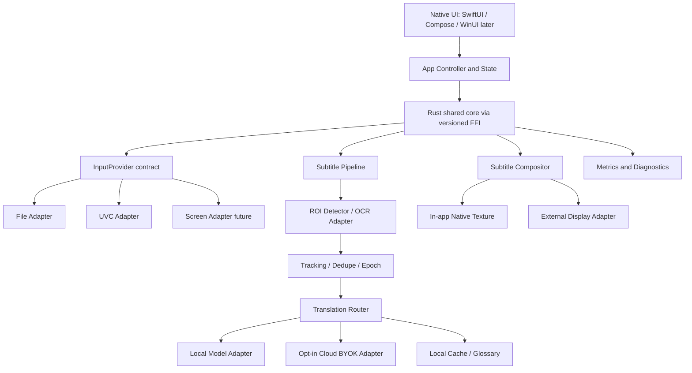
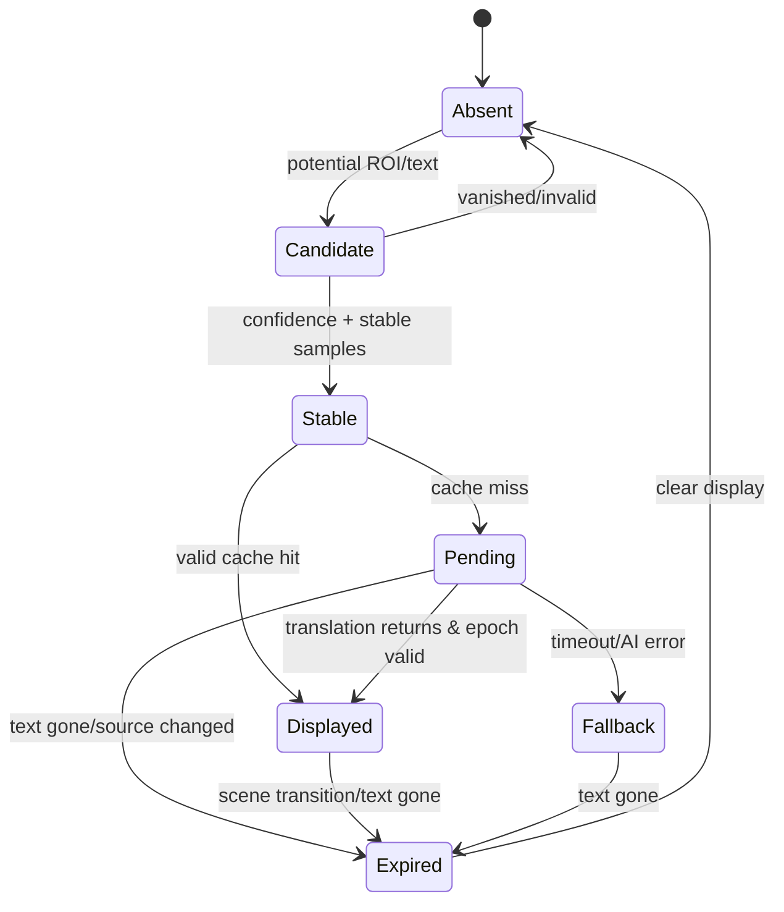

# AI Game Subtitle Translator — Engineering Handoff v2.1

**Status:** Proposed implementation baseline, not an implemented product  
**v2.1 (2026-11-10):** UI changed from Flutter to native per-platform UI (SwiftUI / Jetpack Compose; WinUI later) over the Rust core via UniFFI — see ADR-0006.  
**Date:** 2026-11-10  
**Initial target:** iPadOS (iPad), macOS, Android tablets. **Windows:** deferred, preserved as a required future target.  
**Languages:** English/Japanese spoken-screen text → Thai  
**Modes:** Video File (permanent), UVC Live Capture, optional platform screen capture (later)  
**Translation:** Offline-first; opt-in Cloud BYOK (Bring Your Own Key)  
**Outputs:** In-app preview/fullscreen; external display where hardware supports processed video output

> **Developer contract:** This is a requirements + architecture + verification document. Proposed targets are hypotheses until confirmed with recorded hardware benchmarks. Never label a capability supported without device-specific test evidence. Any decision or code change affecting future Windows implementation MUST update `docs/windows-handoff/WINDOWS_PORTABILITY_LEDGER.md` in the same PR. A PR without the update or a justified `No Windows impact` declaration fails review.

## Contents

1. [Product charter and boundary](#1-product-charter-and-boundary)
2. [Release prioritization and definitions of done](#2-release-prioritization-and-definitions-of-done)
3. [Detailed scope and requirements](#3-detailed-scope-and-requirements)
4. [System architecture and platform adapters](#4-system-architecture-and-platform-adapters)
5. [Video input and audio synchronization](#5-video-input-and-audio-synchronization)
6. [Subtitle detection, OCR and tracking](#6-subtitle-detection-ocr-and-tracking)
7. [Offline translation and model management](#7-offline-translation-and-model-management)
8. [Optional cloud translation / BYOK](#8-optional-cloud-translation--byok)
9. [Subtitle compositor and external displays](#9-subtitle-compositor-and-external-displays)
10. [File Input Mode — permanent feature](#10-file-input-mode--permanent-feature)
11. [Application UI and settings](#11-application-ui-and-settings)
12. [Storage, privacy, security and compliance](#12-storage-privacy-security-and-compliance)
13. [Operational behavior and observability](#13-operational-behavior-and-observability)
14. [Performance budgets and test methodology](#14-performance-budgets-and-test-methodology)
15. [Hardware qualification and test matrix](#15-hardware-qualification-and-test-matrix)
16. [User stories and acceptance criteria](#16-user-stories-and-acceptance-criteria)
17. [Sprint-ready delivery plan](#17-sprint-ready-delivery-plan)
18. [CI/CD, quality gates and release](#18-cicd-quality-gates-and-release)
19. [Windows deferred-portability contract](#19-windows-deferred-portability-contract)
20. [Risks, decisions, unresolved issues](#20-risks-decisions-unresolved-issues)
21. [Security, legal and store gates](#21-security-legal-and-store-gates)
22. [Delivery checklist and developer instructions](#22-delivery-checklist-and-developer-instructions)
23. [Authoritative references](#23-authoritative-references)

---

## 1. Product charter and boundary

### 1.1 Problem statement
Many console/PC games lack Thai subtitles. Users want to watch or play games with readable Thai translations, without modifying game files, jailbreaking devices, bypassing content protection, or requiring a paid translation cloud account.

### 1.2 Core principles (in priority order)

1. **Offline-by-default:** Once the legally distributable model bundle is installed, file playback/capture OCR and EN/JA→TH translation operate with the network physically disconnected. Initial model download may need connectivity; state this explicitly in onboarding.
2. **Video never awaits AI:** Render and audio threads never synchronously wait for detection, OCR, translation or network responses.
3. **File mode is a first-class permanent feature** on all initially targeted platforms, with playback, seek, translation cache, and debugging.
4. **BYOK is opt-in only.** No implicit cloud escalation, upload, or remote processing.
5. **No console/game modifications.** Only lawfully accessible unprotected HDMI/UVC or local user-supplied file sources.
6. **Device-specific support**, no universal claim that every USB-C tablet or capture dongle supports all resolutions, audio, external output, or simultaneous power.
7. **Windows-ready boundaries today:** shared contracts, isolated platform bindings, cross-platform tests, and mandatory Windows handoff ledger updates per PR.
8. **Content minimization:** OCR locally; translations/cache default locally; external request payloads disclose user-selected content and retention implications.

### 1.3 Glossary

- **UVC:** USB Video Class; capture device exposes a standard video interface.
- **UAC:** USB Audio Class; audio capture capability may be a separate interface.
- **BYOK:** user supplies their own provider credentials, pays their own provider account.
- **ROI:** region of interest for subtitle detection; normalized to frame coordinates.
- **PTS:** presentation timestamp; always use source/media time, not just wall time.
- **Generation/epoch:** monotonically increasing ID invalidating all in-flight outputs when seeking, switching sources or starting a new session.
- **TTFS:** time to first stable translated subtitle after subtitle appearance.
- **E2E video latency:** source optical event to displayed optical event; does *not* equal AI translation latency.
- **P95/P99:** measured percentiles with sample count, equipment and method disclosed.

### 1.4 Non-goals for initial releases

- No video game ROM patches, injected game processes, DRM/HDCP circumvention or firmware modifications.
- No universal support for all console outputs, USB-C docks, HDR, VRR, 4K120 or protected streams.
- No promise of preserving dynamic background when replacing baked-in text: mask replacement can be visibly imperfect.
- No batch publishing/transcription sharing service; no crowd-sourced proprietary game subtitle catalog.
- No iPhone/Android phone release required; tablet-only UI and qualification for initial mobile release.
- No Windows binary in initial milestone; Windows architecture preservation is **required**.
- No microphone speech recognition or dubbing in MVP; separate future workstream.
- No background capture when operating system suspends or forbids capture.

---

## 2. Release prioritization and definitions of done

| Release | Target | Required features | Release gate |
|---|---|---|---|
| R0 — Feasibility | iPad + macOS + Android tablet samples | Native UVC probe, hardware accelerated file playback, candidate OCR/model benchmark, output/USB bandwidth tests | Demonstrated, measured per-platform feasibility report; block unsupported 1080p60 promises |
| R1 — Core alpha | macOS + iPadOS + Android tablet | Permanent File Mode; offline EN/JA→TH; overlay; deterministic test runner; local glossary; offline distribution strategy | Functional E2E demo on each target and golden dataset regression |
| R2 — Live alpha | all three | UVC live capture on qualified devices, audio, backpressure, reconnect, low-latency mode, device compatibility view | Console→capture→translated screen demo on all three using known compatible devices |
| R3 — Beta | all three | Cloud BYOK, secure storage, mask-and-replace, external TV output on qualified combinations, observability | Security review, endurance tests, device certification matrix, legal/store review |
| R4 — Production | all three | polished UX, accessibility, telemetry opt-in, signed releases, support materials, store/commercial compliance | All P0 ACs green + legal approvals + reproducible release |
| R5 — Windows | Windows x64 (ARM64 later decision) | Windows media and secure storage adapters + platform UI/packaging while retaining shared core | Windows parity tests, no core architecture rewrite, measured video/AI performance |

**Priority:** R0 first; R1/R2/R3 may overlap only after R0 gates. A release of a mobile store app may require different onboarding/model packaging from direct macOS distribution.

### 2.1 Platform baseline (proposal; validate early)

- iPadOS: USB-C iPad devices with applicable OS support and external UVC access; initial QA baseline iPadOS 17+ **subject to current SDK & supported device certification**. No Lightning input claim.
- macOS: Apple Silicon macOS 14+ as primary QA; Intel **not committed**, analyze feasibility and runtime support separately.
- Android: arm64 tablets Android 12+ as initial QA baseline; UVC compatibility conditional on USB Host, firmware, vendor camera stack, capture mode and permissions.
- Windows future: Windows 11 x64; do not hardwire Apple/Android-only APIs into shared logic.

---

## 3. Detailed scope and requirements

### 3.1 Functional requirements

| ID | Priority | Requirement |
|---|---|---|
| FR-001 | P0 | Open user-selected MP4/MOV/MKV files where platform decoders support the actual codecs; unsupported formats show helpful errors. |
| FR-002 | P0 | Playback: play/pause/seek/speed 0.5–2× (supported media), media duration, scrubbing, audio volume, fullscreen. |
| FR-003 | P0 | Enumerate compatible UVC video devices and formats; require consent; select resolution/FPS and preferred audio input. |
| FR-004 | P0 | Local detection/OCR of English/Japanese subtitle text with auto ROI and manual ROI override. |
| FR-005 | P0 | Fully offline English/Japanese→Thai translation after local model installation. |
| FR-006 | P0 | Thai overlay styling (font/size/position/outline/shadow, safe area, max lines) and clear when scene changes. |
| FR-007 | P0 | Translation state machine + cache + dedupe; never display stale translation after seek/source change. |
| FR-008 | P0 | Uninterrupted video/audio if OCR/AI fail or are slow. |
| FR-009 | P0 | Hardware compatibility checker, diagnostics and test mode before live capture. |
| FR-010 | P0 | File Input Mode remains exposed in release navigation and user documentation. |
| FR-011 | P1 | Mask & Replace with adjustable blur/solid/background sampling; detect when masking damages UI. |
| FR-012 | P1 | Cloud BYOK configurable per provider, permission, test connection and local fallback. |
| FR-013 | P1 | External display of **processed** video on qualified device/dock/TV combinations; no false passthrough claims. |
| FR-014 | P1 | Session statistics, diagnostics export with redaction, FPS/latency and thermal degradation notices. |
| FR-015 | P1 | Translation history, private glossary and per-game profile stored locally, user-controlled purge/export. |
| FR-016 | P1 | Subtitle crop/ROI live preview and bounding boxes in an optional developer/debug overlay. |
| FR-017 | P1 | Model download manager: licenses, sizes, hashes, available storage, resume/rollback and offline status. |
| FR-018 | P1 | Cloud budget estimates and local soft limit, warning/fallback; never advertise provider hard caps. |
| FR-019 | P2 | Subtitle pre-analysis of video files and export of user-authorized translations/sidecar files subject to legal approval. |
| FR-020 | P2 | Screen capture of local PC game windows; macOS optional later, Windows future. |
| FR-021 | P2 | Optional speech-to-text for games without visible subtitles, post-MVP. |

### 3.2 Nonfunctional requirements

| ID | Requirement |
|---|---|
| NFR-001 | Bounded memory and queues; no unlimited frame accumulation or runaway in-flight translations. |
| NFR-002 | Media pipeline, OCR and LLM stage instrumented separately with percentile metrics. |
| NFR-003 | Stable timestamps and A/V sync under seek, pause, dropped frames, reconnect, thermal throttling. |
| NFR-004 | App is usable with keyboard/mouse, touch, screen reader labels and scalable UI. |
| NFR-005 | No credential or protected content written to telemetry/crash logs by default. |
| NFR-006 | Local-only mode makes no translation network requests; optionally verify via packet capture. |
| NFR-007 | Production dependencies and bundled models have documented redistribution/commercial licenses. |
| NFR-008 | ABI-versioned adapters and serialized data contracts suitable for Windows implementation. |
| NFR-009 | User-facing messages distinguish unsupported device vs denied permission vs unsupported stream vs model unavailable. |
| NFR-010 | Power/thermal policy; degrade OCR sample rate/model tier before affecting display continuity. |

### 3.3 User journeys

**First run offline:** choose language pair → privacy notice → hardware inspection → model selection + license/size disclosure → download with checksum or import compatible installed model → open sample owned/licensed video → detect subtitle ROI → see Thai translation → adjust appearance.

**Live console:** connect console to compatible capture card; connect card to tablet/Mac via permitted USB adapter → choose Live Capture → grant permission → select format/audio → preview/video-only smoke test → enable AI → show compatible output paths → start session.

**Cloud opt-in:** Settings → Cloud BYOK → read disclosure → choose provider → add key via secure OS storage → choose model / timeout / budget → explicit Test Connection → enable cloud for current session; offline fallback opt-in or configured default displayed clearly.

**File reopen:** choose recent file via OS file picker/bookmark → validate bookmark and file identity → seek to point → use local cache where subtitle text/context match; invalidate on model/glossary changes.

---

## 4. System architecture and platform adapters



### 4.1 Recommended implementation boundaries

- **Native UI (ADR-0006)**: SwiftUI app shared by iPadOS+macOS (`app/apple`), Kotlin + Jetpack Compose for Android tablets (`app/android`), WinUI/C# for Windows in R5. Navigation, onboarding, settings, dashboards, accessibility. **Do not copy 60fps raw video frames across the FFI boundary**; video stays in native surfaces (Metal layer / SurfaceView / swapchain).
- **Rust shared core**: source/session orchestration, event timeline, subtitle FSM, cache keys, glossary, translation provider interface, cancellation/epoch, typed errors, metrics schema. Do not bind this logic to Apple/Android APIs.
- **Swift/Obj-C++ platform media modules**: iPadOS/macOS AVFoundation device discovery, AVPlayer/AVAsset, audio session and Metal/texture bridge. For iPadOS UVC discover supported external `AVCaptureDevice`; no guarantee all devices expose all modes.
- **Kotlin/C++ Android modules**: Camera2 external camera where enumerated OR vetted user-permission USB-host UVC stack; Media3/ExoPlayer for files; Surface/HardwareBuffer/EGL/Vulkan integration as appropriate.
- **AI delegates**: native runtime selected by device: Core ML/Metal where supported; ONNX Runtime/NNAPI/vendor accelerator or llama.cpp; Rust core interfaces only receive normalized text/tokens and confidence, not platform model handles.
- **Windows future adapters**: Media Foundation/Windows Graphics Capture, Direct3D compositor, Credential Manager/DPAPI storage, Windows packaging; no Windows-only implementation committed yet.

**Architecture decision:** Native UI + Rust core via UniFFI (ADR-0006, supersedes ADR-0004). During R0 still measure binary size, FFI overhead and GPU contention; write ADR if changed.

### 4.2 Shared interface contracts

```rust
pub struct FrameMetadata {
    pub source_id: String,
    pub session_epoch: u64,
    pub frame_seq: u64,
    pub pts_us: i64,
    pub width: u32,
    pub height: u32,
    pub rotation_degrees: u16,
    pub format: PixelFormat,
    pub color_space: ColorSpace,
}

pub trait VideoInputProvider: Send {
    fn capabilities(&self) -> InputCapabilities;
    fn open(&mut self, request: OpenInputRequest) -> Result<InputSession, InputError>;
    fn close(&mut self) -> Result<(), InputError>;
}

pub trait TranslationProvider: Send + Sync {
    fn id(&self) -> ProviderId;
    fn translate(&self, request: TranslationRequest,
                 cancellation: CancellationToken) -> TranslationFuture;
}

pub trait OcrProvider: Send + Sync {
    fn recognize(&self, crop: FrameCrop,
                 hint: LanguageHint) -> OcrFuture;
}

pub trait RenderOutputAdapter: Send {
    fn outputs(&self) -> Vec<OutputCapabilities>;
    fn attach(&mut self, target: DisplayTarget) -> Result<(), OutputError>;
}
```

The pseudocode above is normative for **semantics**, not compiled source: implement async frame callbacks, native texture handles/fences, ownership/lifetime, cancellation and backpressure explicitly. FFI shall expose opaque handles, API version and error codes rather than Rust pointer layout to Swift/Kotlin (UniFFI-generated bindings).

### 4.3 Event/time model

- Session has `source_id`, `session_epoch`, `media_clock`, `start_wall_clock`, `source_mode`, `profile_id`.
- Every detection, OCR, translation and renderer event carries `(source_id, session_epoch, subtitle_id, source_pts_range)`.
- On seek, source switch, reconnection, language/profile change: **increment epoch**, cancel pending tasks, clear visible stale overlay, optionally load valid cached results for new epoch.
- Translator response is accepted only if source+epoch match and expected subtitle is still visible within tolerance; otherwise drop as stale and record metric.
- File `PTS` comes from media timeline; live PTS maps device timestamp to a monotonic capture clock. Never use `Date.now()` as source presentation timestamp.
- Decode-time (DTS) and PTS differ for B-frame video; compositor follows presentation order.

### 4.4 Scheduler/backpressure

```text
Input frame (60 fps) -> bounded latest-frame queue (capacity 2-3)
                      -> native render/audio loop: non-blocking
                      -> downsample/scene-change gate (2-5 OCR checks/sec by default)
                      -> OCR worker(s), bounded concurrency
                      -> stable text tracker / debounce
                      -> cache lookup -> translation single-flight task
                      -> display overlay only if epoch & visibility valid
```

Drop stale OCR candidates before frames used for display. Implement flow control and per-device inference scheduling (do not assume independent GPU resources for rendering, OCR and local LLM). Cancel in-flight work on source/seek/ROI changes. Maintain explicit frame/memory budgets.

### 4.5 Contract schemas

- `schemas/subtitle-event.schema.json` and `schemas/translation-request.schema.json` are canonical message examples.
- Each schema change: bump schema version; add cross-platform decoder tests; record migration notes and Windows impact.
- No platform-specific absolute filesystem paths, localized timestamps, or native object handles in serialized contracts.

---

## 5. Video input and audio synchronization

### 5.1 Input types

1. **FileInputProvider (P0, permanent):** open file with OS picker; playback controls; normalized PTS/seek; supported codecs from platform/media runtime.
2. **UvcInputProvider (P0 after feasibility):** enumerate USB video capture formats; choose lowest stable path; accept optional UAC audio; handle disconnect/reconnect.
3. **ScreenInputProvider (P2):** optional for future desktop use; not required for iPad and Android tablet release.

### 5.2 Format negotiation

- Prefer 1920×1080 SDR at 60fps if tested and offered. Fallback 1080p30 / 720p60 / 720p30, inform user of negotiated format.
- Capture cards may expose MJPEG, YUY2/NV12 and other formats, which do not guarantee low latency; measure decode+conversion cost.
- Do not assume HDR, HDCP, 4K, VRR or USB 2.0 performance; capture only accessible non-protected output.
- Include video/audio format, frame rate stability, pixel aspect, rotation, SDR transfer/color range, input reconnect results in compatibility records.
- Capture card USB bandwidth and USB-C hub topology matter, especially simultaneous external TV and power; qualify physically.

### 5.3 Platform-specific capture

**iPadOS:** Discover UVC-compliant external capture devices using public AVFoundation APIs; request relevant privacy permissions; AVFoundation capture session → native pixel buffers → Metal compositing → render surface. Check simultaneous USB storage/power/video output on each dock; never assume bidirectional DP Alt Mode from a cable.

**macOS:** AVFoundation external UVC; provide permissions/onboarding; optionally ScreenCaptureKit later for desktop screen input; use CoreVideo/Metal for frame surfaces.

**Android:** First attempt `CameraManager` external camera access and enumerate output sizes. If not exposed but USB device permission is granted, evaluate vetted UVC USB Host library (license/compatibility) with isolated adapter. Camera2 external camera guidance explicitly warns it is not designed for all performance-intensive high-speed workloads. Android USB Host requestPermission is mandatory for direct access. If no supported path, show actionable unsupported state rather than crash.

### 5.4 Audio policy

- Prefer source audio PTS timestamps; align display audio to rendered video timeline; do not add translation waiting delay in live mode.
- Sample rate/resampling/clock drift are measured with audible and optical synchronization test assets.
- Capture may expose UAC separately; missing audio is not concealed. Show `Audio unavailable from this capture device` with alternate authorized audio source if possible.
- At pause/seek/reconnect, flush/retime audio buffer and subtitle schedule together.
- For external outputs, use user-selectable audio sink if platform API permits; detect echo caused by duplicated output devices.

### 5.5 Loss/disconnect behavior

| Event | Desired behavior |
|---|---|
| UVC unplug | Show reconnect banner, stop presenting stale live video and Thai subtitle; no app crash |
| Capture format changes | Renegotiate; new epoch; reinit decoder/render path safely |
| USB permission denied | Explain access request and how to retry |
| No usable audio input | Continue video with audio warning (unless user requires audio) |
| Screen locked/app suspended | Obey OS capture/background policies; terminate/restore safely |
| Source HDCP/protected/black | No bypass; show protected or unsupported input guidance |
| Thermal/device pressure | Reduce OCR/inference frequency first; show quality-state notification |

---

## 6. Subtitle detection, OCR and tracking

### 6.1 Detection pipeline

1. Capture low-resolution analysis view from native frame without stalling render.
2. Detect probable subtitle/dialogue ROIs: bottom centered, speech bubbles, dialogue windows, dialogue menus; allow manual crop.
3. Normalize orientation, adjust contrast/edge/perspective conservatively and preserve originals for debug.
4. OCR with `EN`, `JA`, or `AUTO` language hint; keep per-character confidence if available.
5. Track ROI/text across subsequent sampled frames using similarity and geometric stability.
6. Normalize whitespace, Japanese punctuation, Unicode, soft line breaks and typewriter increments without losing meaning.
7. Identify complete/stable utterance; avoid sending each new character to LLM; timer and semantic end-of-sentence heuristics configurable per game.
8. Debounce, dedupe and check local cache; translate only new stable text.
9. Replace or overlay while source remains visible; expire immediately on scene/source change and after configured miss tolerance.

### 6.2 Modes / tuning

- `AUTO`: full-frame detector with adaptive ROI, initial scan before steady-state.
- `BOTTOM_REGION`: restrict to a normalized ROI, improve speed/false positives.
- `MANUAL_ROI`: user draws 1–3 regions, persisted per source/game profile.
- `DIALOG_BOX`: detect stable dialogue panel and its child text bounding boxes.
- Separate UI text suppression: menus, items, controller hints, health bars, quest markers should not automatically be translated as dialogue unless user enables general text mode (future).

### 6.3 OCR acceptance measurement

- Maintain separate English and Japanese datasets from **authorized, self-created, or licensed assets**, with diverse fonts, black/white outlines, gradients, animated backgrounds, katakana, kanji, furigana and typewriter animations.
- Score `CER = edit_distance(characters)/reference_character_count`, report `1-CER` as character accuracy (may be negative before clamping; document metric method). Also report word/token error where appropriate, detection recall, false positive / minute and onset delay.
- Translation quality assessment uses native Thai evaluators and domain-specific consistency, not BLEU alone.
- Do not call detection accuracy and OCR character accuracy the same metric.

### 6.4 Subtitle state machine



**Rules:** One active translation per subtitle region; `translation_id` unique per stable content+context; no UI flicker from OCR minor changes; stale cloud response never resurrects expired subtitle; cache hit display must still validate context and epoch.

### 6.5 Mixed-language and OCR failure

- For AUTO identify language distribution; do not feed Japanese kanji to English-only OCR as a silently accepted result.
- Low confidence: leave original subtitle visible or show user-configured minimal overlay; never hallucinate fabricated translations for unreadable text.
- Avoid translating names/numbers blindly; respect glossary and protected tokens.
- If only a portion is recognized, wait a bounded settling window instead of repeatedly replacing translations with inconsistent fragments.

---

## 7. Offline translation and model management

### 7.1 Local inference selection

Treat models as benchmark candidates, **not selected dependencies until license + quality + memory + speed gates pass**. Compare at least:

- Small multilingual instruction-tuned LLM family (e.g., Qwen-derived candidates) with commercial redistribution check.
- Encoder-decoder machine translation models (e.g., multilingual MT candidates), separately score EN→TH and JA→TH.
- Quantization configurations to balance mobile memory, Thai punctuation and script quality.

Model scorecard per platform: model id+version+license; installed bytes; loaded memory peak; prompt/context tokens; sustained output tokens/sec; TTFS/translation P50/P95; EN/JA quality panel; peak thermal/battery; unsupported fallback behavior.

### 7.2 Runtime adapters

- Apple: evaluate Core ML and model packaging/compilation plus Metal and/or llama.cpp where licensed and compatible; model memory shared with UI/video pipeline.
- Android: evaluate ONNX Runtime with available EP and CPU fallback, native inference libraries, GPU/NPU vendor variability. Avoid claiming NNAPI acceleration when provider not used/available.
- Shared Rust: stable `LocalTranslator` interface, no hard dependency on Core ML or Kotlin.
- Dynamic model download: permitted model weights/data only; comply with Apple store policies governing downloaded executable code and platform distribution; notarize/sign executables appropriately.

### 7.3 First-launch model onboarding

1. Detect device capability (OS, architecture, memory pressure, available disk, accelerator exposure).
2. Recommend a tested **supported** model tier, with unsupported alternatives disabled or labeled experimental.
3. Display size/license, expected RAM and internet required for first install.
4. Download over HTTPS from approved provider/CDN or package with app if distribution permits; verify SHA-256 and signed manifest.
5. Atomically install; preserve last good version; recover partial downloads; verify space before install.
6. Run small EN/JA→TH self-test with canned content; state `READY`, `DEGRADED`, or `UNAVAILABLE`.
7. Offline behavior: app opens files and can render video without a model; show setup prompt and do not falsely show offline translate ready.

### 7.4 Prompt/pipeline requirements

- Provide language and compact recent dialogue context, selected character glossary/style, locale = Thai.
- Keep prompt tokens bounded and separate source text from instructions; treat OCR output as untrusted data, never follow commands appearing within video dialogue.
- Name consistency overrides flexible wording; avoid adding explanations, fabricated story facts or commentary in subtitles.
- Return strictly one translated subtitle entry and confidence/status metadata; sanitize output length and markup.
- Segment long lines by Thai grapheme-aware layout, not arbitrary byte lengths; avoid breaking combining marks.

### 7.5 Local failure cases

- OOM → terminate/release model safely, suggest smaller tier; video playback continues.
- Thermal throttling → reduce OCR rate, enable lightweight translation mode; stop if device temperature/policy requires.
- Model hash/license failure → quarantine package and require replacement; do not use unverified weights.
- Language unsupported → explicit message; no silent fallback to different source language.
- User disables model or removes downloaded model → file preview still functional.

---

## 8. Optional cloud translation / BYOK

### 8.1 Product rules

- Default `OFFLINE`. Cloud requires explicit opt-in and informed disclosure of text sent, receiving provider, billing impact and privacy terms.
- Supports provider abstraction for OpenAI/Gemini/Anthropic as candidate endpoints; actual direct client API key support **must be reviewed against each provider's policy**, which may recommend/require server-side credential handling.
- Provider connection test must never reveal key or log Authorization header.
- `AUTO` switching to Cloud is **off by default**; no cloud request in offline mode, even if a key is stored.
- Estimate cost from provider published token prices only after current verification; an in-app spend guard is soft and not a provider-level spending cap.

### 8.2 Secret storage / network

- Apple (iPadOS/macOS): Keychain Services with appropriate accessibility/access group.
- Android: Android Keystore-backed encryption and app-private storage; require explicit secure-storage failure handling.
- Windows future: Credential Manager or DPAPI-backed storage (do not invent platform-agnostic key store API).
- No API key in UI state persistence (SwiftUI/Compose saved state), SQLite/plaintext logs, analytics, crash reports, URL query string, shared clipboard automatically, or build settings.
- Credentials only go to explicitly user-confirmed provider endpoint, through native request layer, with HTTPS verification. No user-entered custom HTTP endpoints in MVP.
- If provider prohibits exposed API key use from distributed native clients, do not implement unsupported direct-key pathway; use supported OAuth/token flow or user-managed proxy only after explicit design/legal review.

### 8.3 Request and fallback

- Provider request includes source language, recognized text, bounded conversation context, glossary, style, request id, timeout budget, not full raw video.
- Cache key includes source language/target, model id+version, prompt template version, glossary hash, normalized text and relevant context hash; **no key material**.
- Error categories: `KEY_INVALID`, `RATE_LIMIT`, `BILLING_REQUIRED`, `TIMEOUT`, `NETWORK_OFFLINE`, `POLICY_BLOCKED`, `PROVIDER_UNAVAILABLE`, `BUDGET_SOFT_LIMIT`.
- Fallback by explicit user setting: on cloud failure local model translates current still-visible subtitle; do not replay stale text after scene change.
- Users can delete key, disable cloud network and clear translation history separately.

### 8.4 Provider adapter sketch

```text
translate(request)
  assert(request.userOptedIntoCloud == true)
  assert(provider endpoint allowlisted)
  assert(key loaded from OS secure store)
  require(epoch still current)
  send minimal OCR text/context over TLS
  validate response schema & length
  if still visible -> render translated subtitle
  else -> discard stale response
```

---

## 9. Subtitle compositor and external displays

### 9.1 Render modes

1. `OVERLAY`: draw Thai text in configured safe area while original remains; fastest, reliable fallback.
2. `MASK_REPLACE`: cover original text box with adjustable translucent/solid/background-sampled patch, then draw Thai; **visually imperfect on animated backdrops**.
3. `INPAINT` (future optional): temporal background reconstruction, only after GPU/latency/license tests; not MVP release gate.

No injection or modification of console game output itself. The application renders a processed preview created from captured unprotected video frames.

### 9.2 Typography / UI composition

- Thai grapheme-safe line wrapping, glyph shaping, font license documentation, outline/background controls, text safe zones for notched/rounded screens, high DPI.
- max subtitle rows default 2; configurable for longer Thai translations and dialogue modes.
- 1080p reference layouts; scale according to video viewport, not device physical pixels.
- Do not block GPU render thread on dynamic font metrics or AI request.
- Optional A/B toggle: original-only/translated/dual-language; original never erased permanently from source media.

### 9.3 External TV output

- Processed output path must be `capture -> local compositor -> supported external display`, not capture-card hardware passthrough.
- macOS: display/window selection, HDMI/USB-C output; verify mirrored vs separate external scene and audio sink.
- iPadOS: external display capabilities depend on model, OS, USB-C dock and resource topology; route to native external scene where supported. Mirroring may mirror app controls rather than clean game video; product must expose selected mode clearly.
- Android: `DisplayManager`/presentation or manufacturer screen-mirroring path where allowed; simultaneous USB host + video out is NOT universal. No TV promise outside qualified combinations.
- User can select primary/secondary display; if unplugged, compositor returns safely to app display without black-screen lock.
- `TV-OUT` requires separate certification for output refresh, A/V sync, cable/dock stability and USB load.

---

## 10. File Input Mode — permanent feature

**Normative:** File Input is a product capability, not a hidden dev flag and not removable after Live Capture ships. It must appear on the launch screen in production iPadOS/macOS/Android releases.

### 10.1 Formats and handling

- Containers: MP4/MOV/MKV *where system media stack supports container+codec*. Do not promise all codec profiles or DRM media.
- MVP preferred codecs H.264/AAC in MP4; add HEVC, VP9/AV1 and MKV compatibility when verified per platform. Android Media3 and Apple AVFoundation have different supported permutations; unsupported file is a product-level error with details.
- Import with native file picker and document-access permissions. Use security-scoped bookmarks on Apple if needed; Android SAF URI permission persist as needed.
- Stream decode; do not duplicate entire imported file without consent; no implicit permanent uploads.
- User can browse folder/recent files with permission; file metadata is stored privately.

### 10.2 Required controls

Play, pause, resume, seek, 10s skip, adjustable speed, volume/mute, fullscreen, subtitle toggle, language hint, OCR ROI, subtitle text size/position, cache clear, translation mode, external-display choice if available.

### 10.3 Seek semantics and reproducible tests

- Seek increments epoch; clear old pending translation and overlays immediately; locate presentation timestamps after keyframe/decode preroll; debounce OCR after seek settles.
- Playback-rate changes must not alter source subtitle PTS. OCR crop sampling based on media-time cadence, with real-time CPU budget.
- Deterministic testing: optionally decode at fixed timestamps, record canonical OCR stage inputs/outputs and stable model settings; no nondeterministic cloud answers in golden gates.
- File test replay CLI/runner need not be a user feature, but should use the **same shared core** as release app.

### 10.4 File test modes

- `REALTIME`: video plays at nominal media clock; AI late results displayed only if still relevant.
- `BATCH_ANALYSIS`: frames processed non-real-time; output JSONL report for evaluation (developer tooling); no requirement for frame-accurate final encoded video export in MVP.
- `DEBUG_VISUAL`: opt-in OCR ROI, bounding boxes, current source text, session epoch, OCR/translate latencies, model ID.

---

## 11. Application UI and settings

### 11.1 Screen inventory

| Screen | Core functions | Mobile/tablet considerations |
|---|---|---|
| Home | File / Live Capture tiles; Recent Files; connection status | Large tap targets, landscape first, portrait fallback |
| First Run | permissions, offline model install/license/privacy | Storage and power warning |
| File Browser | OS picker, recent accessible items, compatibility info | Android SAF, Apple document picker |
| Live Devices | UVC listing, negotiated format, audio availability, test connection | USB permission and dock diagram |
| Player | Video, Thai overlay, transport controls, source info | Minimal chrome during gameplay |
| ROI Editor | Draw/resize/move subtitle region, preset | Touch handles, reset auto, preview |
| Translation Settings | Offline/Cloud opt-in, language, model tier, prompt style | Explicit clear cloud consent |
| BYOK Settings | Provider/key status, secure add/delete, model, soft budget | Never echo key / log raw strings |
| Model Manager | installed/downloadable models, license, size, health | Battery/storage warnings |
| Display & Audio | fullscreen, monitor/TV, aspect, safe area, audio sink | Show only supported output actions |
| Diagnostics | FPS, missed frames, OCR latency, model health, USB mode | Export redacted diagnostics |
| Game Profiles | ROI, terminology, per-game style | No shared licensed-game transcript catalogs |
| Help/Legal | supported devices, privacy, copyrights, licenses, troubleshooting | App Store reviewer demo flow |

### 11.2 UX requirements

- Visibly separate `Video File` and `Live Capture` from day one.
- Distinguish loading model vs using model; display when network is required to install model vs when translation is offline.
- Show explicit display warning if user selected unprocessed hardware passthrough.
- On-screen cloud indicator when remote translation is enabled; click to disable instantly.
- When model too slow, suggest smaller model, reduce OCR scan, or switch to user-approved Cloud—not automatic off-device transfer.
- Localize app UI to Thai and English; accessibility announcements for permission errors.

### 11.3 Suggested settings example

```yaml
schema_version: 1
input:
  preferred_mode: file
  live_preferred_format: { width: 1920, height: 1080, fps: 60, sdr: true }
subtitle:
  input_language: auto # en | ja | auto
  output_language: th
  roi_mode: auto # bottom | manual | dialogue
  render_mode: overlay # mask_replace
  font_size_scale: 1.0
translation:
  provider: offline # cloud requires explicit consent
  local_model_id: null
  glossary_id: default
  cache_enabled: true
  cloud:
    enabled: false
    provider: null
    model: null
    credential_ref: null # never raw API key
    fallback_to_offline: true
    estimated_session_soft_limit_usd: 5
privacy:
  telemetry_opt_in: false
  persist_translation_history: false
```

---

## 12. Storage, privacy, security and compliance

### 12.1 Data inventory

| Data | Location | Lifetime | User control |
|---|---|---|---|
| Model weights + manifests | App-managed local storage | Until uninstalled/removed | Delete model |
| Per-game ROI/glossary | Private local DB | Until deleted | Export/delete |
| Translation cache | Private local DB, encrypted if feasible | Bounded TTL/size by config | Clear cache |
| Video file | Original user-controlled location | Not copied by default | File picker permissions |
| Cloud credential | OS secure store | Until removed | Delete/replace/revoke instructions |
| Logs | Local, redacted by default | Rolling bounded retention | View/export/delete |
| Cloud OCR payload | Provider service when user opts in | Provider policies | Provider-specific rights/disclosure |

### 12.2 Privacy controls

- Offline mode: no request to cloud translation endpoint. Model/package download, app updates and licensing network may occur separately **only as clearly disclosed**; provide offline test that blocks all network and uses pre-installed model.
- Cloud requires user action + disclosure identifying text sent and provider; never send whole video or screenshots by default.
- Debug screenshots/crops OFF by default; explicit consent for export and automatic retention bounded.
- Prompt injection: game subtitles and file contents are **data**; never execute commands, tool calls, URLs or instructions from recognized text.
- Device diagnostics must exclude key, text of game dialogue unless user explicitly opts to export a reproducer.

### 12.3 Security baseline

Threats: malicious media file/codec, crafted USB device, prompt injection, exposed BYOK credentials, rogue model downloads, logging leaks, third-party provider policies, tampered runtime, unsafe DRM handling.

Controls: OS decoder sandbox/hardening where available; dependency scanning; restrict USB permissions; signed hashes and model allowlist; HTTPS; redacted logs; Keychain/Keystore; no custom arbitrary script execution; content limits; fuzz tests for subtitle normalization and schema parsing; zeroize tokens as appropriate; crash reports no content by default; vulnerability and incident reporting.

### 12.4 Legal and store readiness

- Legal counsel must assess copyright adaptation of game dialogue, temporary translation for personal viewing, cloud transfer, translations cache/export, user-supplied video, game terms and platform EULAs by target market.
- Do not include game logos, frames or dialogue excerpts in marketing or fixtures unless owned/licensed/permitted; use self-created fictional video samples.
- Keep third-party OSS and AI model license BOM with attribution, model redistribution and paid-license compatibility.
- Apple App Store rules about third-party protected content, privacy, downloadable software/model assets, device review and payments must be reviewed before submission; Google Play policies separately.
- No HDCP/DRM bypass, console jailbreaking or unauthorized game modifications.

---

## 13. Operational behavior and observability

### 13.1 Metrics schema

- Media: `capture_fps`, `render_fps`, `dropped_capture_frames`, `dropped_render_frames`, `queue_depth`, `pts_drift_ms`, `av_sync_ms`, `cpu_pct`, `gpu_load_if_available`, `rss_mb`, `thermal_state`.
- AI: `ocr_crops_per_sec`, `ocr_p50_p95_ms`, `detection_recall_eval`, `ocr_cer_eval`, `translation_p50_p95_ms`, `cache_hit_ratio`, `stale_response_discard_count`, `translation_timeout_count`, `model_peak_mem_mb`.
- Cloud (only opt-in): `provider_status_code_class`, `token_estimate`, `cost_estimate`, `timeouts`, `budget_warnings`; no text or secrets.
- Device: USB vendor/product IDs (optional diagnostic export only), interface/alt settings, FPS/format, reconnect count, external display refresh and failure codes.
- Every measurement includes platform, OS build, device model, capture card firmware/model, model version/quantization, source codec, resolution, test fixture version.

### 13.2 Log levels

- `INFO`: source selected, format negotiated, model load, route chosen (no secrets).
- `WARN`: OCR confidence low, translation timeout, thermal downshift, USB unstable.
- `ERROR`: decoder crash, model corrupt, key storage error, unsupported output.
- `DEBUG`: bounded opt-in; no raw subtitle text, prompt, frames or API key unless a dedicated explicit privacy-safe fixture mode is used.

### 13.3 Crash recovery

- Recover playback even if translation engine crashes; isolate inference where platform architecture permits.
- Store nonsecret preferences atomically; rotate cache/version; preserve previous model manifest on failed upgrade.
- On hard error show local diagnostics ID and clear remediation path; no silent black screen.

---

## 14. Performance budgets and test methodology

**These are proposed acceptance targets, not guaranteed outcomes. Freeze thresholds after R0 measured feasibility and document amendments by ADR + Windows ledger.**

### 14.1 Distinct latency budgets

| Metric | Candidate target on certified devices | How to measure |
|---|---|---|
| File playback | Nominal 1080p60, 99% frames presented in 10-minute reference session | timestamped frame trace vs player media clock |
| Live capture video latency | P95 ≤ 120ms on qualified 1080p60 input path; device-specific | LED/high-speed camera capture and displayed response, ≥200 events |
| External display added latency | P95 additional ≤ 50ms vs in-app on certified dock | same-scene two-display optical measurement |
| A/V sync offset | within ±80ms P95 on qualified routes | flash+click fixture with high-speed camera/audio recorder |
| OCR onset after stable subtitle | P95 ≤ 500ms (sampling schedule dependent) | annotated PTS to stable recognition event |
| Offline translation after stable OCR | P95 ≤ 1200ms for selected certified model/device and test length | monotonic time, ≥200 subtitle cases |
| Subtitle time-to-first-stable-Thai | P95 ≤ 1800ms target (file/live, no intentional delay) | subtitle appearance PTS to first valid Thai on screen |
| Application stability | 2h uninterrupted file/live test; 0 crashes | structured log + watchdog evidence |
| Thermal performance | No runaway; maintain declared degraded mode at 60min | power + thermal trace |

For heavy AI or low-tier devices, define **separate advertised compatibility classes** rather than failing all tablets against one aggressive number. A product can display live video smoothly while Thai subtitle arrives later; never conflate the two.

### 14.2 Methodology

1. Warm-up and cold-start runs recorded separately.
2. Record device/capture/codec/model/config and network conditions (if cloud).
3. Measure ≥200 subtitle cases per language across at least 5 different self-created styles/fixtures; report 50/95/99th as applicable and sample count.
4. Instrument visual timestamps for live input; real time optics test separate from software timers.
5. Seek test rapidly across dialogue to catch stale overlay; check epochs in event trace.
6. Test 1, 5, 30, 60, 120 minutes, power plugged/unplugged on tablet.
7. Repeat with external TV, passive hub, powered hub, different capture formats; unsupported combos explicitly fail qualification.
8. Every regression report links fixture hash + test runner commit.

---

## 15. Hardware qualification and test matrix

### 15.1 Minimum actual lab equipment

- One current USB-C iPad with documented UVC capability, preferably another less powerful iPad for performance baseline.
- One Apple Silicon Mac with at least two video output configurations.
- At least **two distinct Android tablet OEM/chipsets**, one explicitly reporting external camera via Camera2 if available, one USB Host test path.
- Two or more UVC capture cards with known format tables, one with UAC; powered USB-C hub/dock and multiple USB-C cables.
- Nintendo Switch (docked supported model) or Switch 2, PS5 or PS4 with legal capture settings, Xbox Series where accessible; record consoles individually.
- 1080p60 and 720p60 source generator/console, HDMI display, high-speed camera, audio sync fixture, USB topology inspection.
- Authorized self-made EN/JA gameplay-like videos with known timestamps and clean ground truth; do not bundle copyrighted game assets without rights.

### 15.2 Certification matrix fields

| Field | Example / requirement |
|---|---|
| OS and version | exact build |
| Tablet/Mac | model identifier, RAM, SoC, USB-C specs |
| Capture card | USB VID:PID, firmware, UVC/UAC formats |
| Dock/cable | exact product and power supply |
| Source | specific console + video format, no bypass |
| Input mode | file/UVC/TV-out |
| Negotiation | actual width/height/fps/pixel format/audio |
| Test result | PASS / FAIL / CONDITIONAL / NOT TESTED |
| Observations | fps, latency percentiles, thermal, A/V |
| Evidence | log ids, recording, QA report |

### 15.3 Required test cases by matrix group

- iPadOS: UVC discovery, sustained capture 1080p30/60 where supported, audio, app foreground/suspend, charge+capture+TV dock, external monitor clean output, model memory/heat.
- macOS: UVC permissions, unplug/replug, multiple display, native full-screen and drag, 2-hour file+live run.
- Android: Camera2 external listing, USB Host permission path, MJPEG/YUY2 negotiation, vendor-specific failure, screen orientation, charging/dock behavior, thermal throttling.
- Consoles: Switch dock mode, Switch 2 compatible TV output mode, PS4/PS5 gameplay capture with protected sources avoided, Xbox video modes; no copyrighted clip bundled in fixtures.
- File formats: H.264/AAC MP4 (P0), MOV/MKV (validated subsets), variable frame rate, B-frames, seek-heavy, silent files, 720p/1080p, invalid/corrupted file.

### 15.4 Evidence bundle

`docs/qa/evidence/<date>_<platform>_<device>/` with anonymized manifest, test logs, charts, screenshots of **authorized** fixtures, environment/versions, PASS/FAIL and known issues. For automated performance metrics also export CSV/JSONL. Update device compatibility list before marketing claims.

---

## 16. User stories and acceptance criteria

**Definition of acceptance:** each AC has reproducible setup, steps, assertions, device/fixture IDs, artifact evidence, pass/fail owner; QA may mark `BLOCKED` with reason. Target numbers from §14 are proposal until frozen after R0.

| AC | P | Scenario and verifiable pass condition |
|---|---|---|
| AC-001 | P0 | iPadOS opens authorized MP4/H.264 file and plays audio+video with usable seek/pause. |
| AC-002 | P0 | macOS opens same fixture, supports fullscreen, displays accurate media time after seek. |
| AC-003 | P0 | Android tablet opens same fixture using OS file picker/SAF; no inaccessible raw-path reliance. |
| AC-004 | P0 | File Mode visible on production Home on all 3 platforms; no debug entitlement required. |
| AC-005 | P0 | EN OCR dataset meets separately agreed CER/recall gate; raw per-case report generated. |
| AC-006 | P0 | JA OCR dataset meets separately agreed CER/recall gate; furigana/font stress included. |
| AC-007 | P0 | Device-local EN→TH translation functions with all network interfaces blocked after model installed. |
| AC-008 | P0 | Device-local JA→TH translation functions offline; model/time/quality measurements attached. |
| AC-009 | P0 | Playback stays responsive while translation sleeps/fails for 5 seconds; bounded queues verified. |
| AC-010 | P0 | Seek forward/back during in-flight translation never displays subtitle from prior epoch. |
| AC-011 | P0 | Subtitle disappears when OCR source vanishes; no permanent stuck overlay. |
| AC-012 | P0 | Thai script graphemes render correctly, line-wrap and outline on target DPI and portrait/landscape. |
| AC-013 | P0 | App shows exact available model/disk requirement and handles no-model/depleted storage gracefully. |
| AC-014 | P0 | Device compatibility gate prevents claiming unsupported UVC device is supported. |
| AC-015 | P0 | iPad certified UVC device is enumerated and rendered with permission and selected negotiated format. |
| AC-016 | P0 | macOS certified UVC device works through unplug/replug and video retains A/V alignment. |
| AC-017 | P0 | Android certified USB device works through Camera2 or permitted USB Host path and survives unplug. |
| AC-018 | P0 | Input switch file↔UVC resets stale translations and preserves intended current preferences. |
| AC-019 | P0 | Real playback under normal load meets agreed video frame throughput; evidence and hardware IDs saved. |
| AC-020 | P0 | No captured frame/raw subtitle content or cloud credential appears in default diagnostic export. |
| AC-021 | P0 | Unit/contract tests for shared core pass without macOS/Android hardware bindings; Windows stubs compile or are interface-validated. |
| AC-022 | P0 | Every merged PR changing cross-platform logic includes completed Windows ledger impact or explicit No Impact justification. |
| AC-023 | P1 | Cloud is off by default: packet inspection shows no translation API requests absent explicit opt-in. |
| AC-024 | P1 | BYOK key stored only in OS secure storage; replace/delete tested and no logging. |
| AC-025 | P1 | Cloud provider error/key invalid/budget warning displays actionable status and local fallback behavior. |
| AC-026 | P1 | Mask & Replace covers selected source text ROI without covering unrelated UI outside ROI. |
| AC-027 | P1 | On qualified macOS setup processed Thai video reaches TV while capture-card passthrough remains original. |
| AC-028 | P1 | On qualified iPad dock processed Thai video reaches external display with no loss of capture stability. |
| AC-029 | P1 | On qualified Android tablet/dock processed Thai video reaches TV; unsupported devices show clear alternative. |
| AC-030 | P1 | Session metrics provide latency percentile, dropped frames, model and device versions with no secrets. |
| AC-031 | P1 | EN/JA evaluators approve glossary names/character tone on blind sample scorecard. |
| AC-032 | P1 | After 60-minute sustained tablet run degradation policy maintains stable video without thermal crash. |
| AC-033 | P1 | Corrupt media and corrupt model signatures fail safely and preserve prior valid model. |
| AC-034 | P1 | External display disconnect returns to internal screen cleanly. |
| AC-035 | P1 | All licensing, model distribution rights, game-content/privacy and app-store reviews signed off before commercial submission. |
| AC-036 | P2 | Optional screen capture introduced only with platform permission tests and no change to core translator contract. |

### 16.1 Named E2E critical test scripts

**E2E-01 File Offline:** Airplane/offline network → open 2-minute licensed EN and JA fixtures → model ready → pause/seek 8 times → verify correct Thai overlay only for visible source, with no network calls.

**E2E-02 Live UVC:** Connect supported console→UVC→iPad/Mac/Android → grant permissions → choose 1080p30/60 where available → 10-minute playback with scene changes → record latency, frame drops and audio.

**E2E-03 Seek Race:** OCR a subtitle → trigger long translation → seek forward → previous translation returns → assert rejected; repeat while swapping file and UVC device.

**E2E-04 Cloud Opt-In:** Disable network/cloud → verify local mode → add test key to secure store → enable Cloud → simulate 401/429/5xx/timeout → show correct messages/fallback and redact key.

**E2E-05 TV-Out:** On approved dock, attach external display while UVC capturing → render Thai over processed feed on TV → unplug TV → fail over to app display; measure latency and A/V.

**E2E-06 Windows Safety:** Run shared core cross-platform contract tests + compile tests for non-native API boundaries; compare dependency/license manifest and change ledger.

### 16.2 Golden fixtures requirements

- `fixtures/manifest.yaml`: fixture IDs, SHA-256, owner/license, source language, frame rate, codec, resolution, expected subtitle events with PTS and bbox, prohibited redistribution markers.
- Golden test media must be generated/owned/licensed; use black-box synthetic backgrounds and invented game-like dialogue to avoid legal contamination.
- Reference OCR and translations stored per model version; compare errors separately from nondeterministic model wording.

---

## 17. Sprint-ready delivery plan

### 17.1 Epic backlog (dependencies)

| Epic | Work packages | Dependency | Deliverables |
|---|---|---|---|
| E01 Foundation | monorepo, native SwiftUI/Compose shells, Rust core, UniFFI, CI, schema/versioning | none | build on iPadOS/macOS/Android; shared core test harness |
| E02 File Playback | Apple AVPlayer/AVFoundation, Android Media3, timeline, audio, native texture | E01 | permanent video file app screen + automated fixtures |
| E03 OCR | ROI UI, detector/recognizer adapters, normalization, tracking, metrics | E02 | EN/JA OCR benchmark + editable ROI |
| E04 Local AI | model runtime benchmarks, model manager, Thai translation context, glossary | E01/E03 | offline EN/JA→TH at target device tiers |
| E05 Compositor | Thai typography, overlay, mask, video texture, timing | E02/E03/E04 | stable translated playback in files |
| E06 iPad UVC | AVFoundation device negotiation, UAC, permissions, reconnect | E01/E05 | certified iPad live console demo |
| E07 macOS UVC | capture device/format/audio/monitor selection | E01/E05 | certified Mac live demo |
| E08 Android UVC | Camera2 external + permitted USB Host fallback decision | E01/E05 | certified Android live demo |
| E09 Cloud BYOK | cloud opt-in, secure credential adapters, billing soft cap, errors | E04 | secure multi-provider prototype |
| E10 External Output | native display controller, dock compatibility, audio routing | E05/E06-E08 | certified processed TV output |
| E11 QA/Hardening | instrumentation, stress, accessibility, privacy, store review, BOM | ongoing | reproducible release evidence |
| E12 Windows Preservation | all-platform contract tests, ledger/ADRs, stub interfaces | every epic | portable contracts and handoff artifacts |

### 17.2 Sprint templates

For each ticket include: `User story`, `Technical approach`, `Platform(s)`, `Dependencies`, `Security/privacy`, `Acceptance criteria`, `Instrumentation`, `Test fixtures`, `Windows impact`, `Risks`, `Evidence`, `Owner`, `Reviewers`.

### 17.3 Mandatory spike deliverables before final model/framework choice

- **SPK-01:** Run UVC live capture on 2 iPads/1 Mac/2 Android devices; save negotiated format and measured delay.
- **SPK-02:** Benchmark local translation EN→TH and JA→TH across candidate models/quantization; generate decision scorecard and model license review.
- **SPK-03:** Benchmark native rendering (Metal/SurfaceView) while OCR+LLM share GPU/CPU.
- **SPK-04:** Test USB hub input+external TV+charging simultaneous on each tablet; document unsupported combinations.
- **SPK-05:** App Store model download/distribution and BYOK provider compliance review.

---

## 18. CI/CD, quality gates and release

### 18.1 Repository layout

```text
app/
  apple/                     # SwiftUI app (iPadOS + macOS), XcodeGen project.yml
  android/                   # Kotlin + Jetpack Compose app (Gradle)
core/
  rust/                      # subtitle FSM, time, scheduling, contracts, cache
  ffi/                       # UniFFI bindings (Swift, Kotlin; C# later)
platform/
  apple/                     # Swift AVFoundation/Core ML/Keychain/Metal
  android/                   # Kotlin Camera2, USB Host, Media3, Keystore
  windows/                   # future stubs and documented adapter contracts
models/
  manifests/                 # legal manifests, test metadata, hashes (no unauthorized weights)
fixtures/
  manifest.yaml              # licensed/synthetic fixtures only
schemas/
  subtitle-event.schema.json
  translation-request.schema.json
tests/
  core/ integration/ e2e/ perf/ security/
docs/
  architecture/decisions/    # ADRs
  platforms/                 # certification matrices
  windows-handoff/           # mandatory portability ledger
  qa/                        # benchmark reports and test evidence
  operations/                # release/runbooks
scripts/
  check_windows_impact.sh    # CI check for ledger/No Impact rationale
```

### 18.2 CI jobs

- PR: fmt/lint Rust/Swift/Kotlin; unit tests; dependency and secret scanning; JSON schema checks; size checks; cross-platform interface tests.
- macOS build agent: iPadOS and macOS app compile/sign staging where permitted; native Apple tests with device farm/manual QA for USB hardware.
- Android build agent: AAB/APK compile; emulator file playback tests + real UVC device lab runs.
- Windows port readiness: periodic shared Rust core `x86_64-pc-windows-msvc` cross-check on Windows runner for pure core; no forced Windows UI implementation.
- Mandatory CI script checks Windows impact ledger update or `windows-impact: none` with rationale in PR template. CI cannot prove quality of narrative; reviewer verifies.
- Release: code-signed and notarized macOS direct package as applicable, App Store/TestFlight submission for iPadOS, Android signing/Play tracks, crash rollback and integrity check.

### 18.3 PR checklist (must copy to every PR)

```markdown
- [ ] Requirement / AC ID linked and updated
- [ ] Offline default and data flows preserved
- [ ] Input/AI/render thread nonblocking and bounded
- [ ] New dependency/model license and SBOM updated
- [ ] Tests + fixtures + benchmark evidence attached
- [ ] iPadOS/macOS/Android implications reviewed
- [ ] Windows impact ledger updated OR No Windows impact explained
- [ ] ADR added for changed public interfaces/architecture
- [ ] No secrets/game assets included in commit
- [ ] UI/permission/errors/accessibility verified
```

---

## 19. Windows deferred-portability contract

**Windows work is deferred, not forgotten.** Every platform-facing design must explicitly consider Windows, even though initial app binaries only target iPadOS/macOS/Android.

### 19.1 Invariants to enforce from first commit

1. Rust `core` compiles without Apple/Android SDK imports; isolate feature flags/platform bindings.
2. Each native UI keeps the same screen inventory and behavior (§11); never assume touch-only navigation; keyboard/mouse/large-screen behavior recorded.
3. Raw frames exchange native opaque texture/surface handles with platform adapter; no core dependency on `CVPixelBuffer`, `SurfaceTexture`, `AHardwareBuffer`, `Metal` etc.
4. Frame/clock/ROI/translation/metrics schemas use common types, little assumptions about encoding; serialization and ABI versioned.
5. Secure credential API abstract (`SecretStore`) with iPad/macOS Keychain, Android Keystore, Windows future Credential Manager/DPAPI.
6. Filesystem interactions go through `FileAccess` abstraction; no persisted Apple security-scoped URL as platform-independent document identity.
7. AI inference is a runtime adapter; Windows can choose DirectML/ONNX/CUDA/CPU or other valid runtime without editing translation FSM.
8. Render output abstract; Windows future D3D11/D3D12 without rewriting AI pipeline.
9. Video File and UVC input contracts generic; Windows future Media Foundation receives same normalized frame/PTS/audio events.
10. Each dependency/model package assessed for Windows supported targets and vendor licenses.

### 19.2 Mandatory per-change documentation

Edit `docs/windows-handoff/WINDOWS_PORTABILITY_LEDGER.md` in the **same PR** whenever any of these change: public/core API, FFI, media formats, model runtime, native rendering, filesystem, secrets, packaging, UI navigation, settings, schema, dependency, security policy, latency instrumentation, or acceptance tests. Every ledger record: date/PR, original requirement/decision, changed components, Apple/Android behavior, Windows implementation equivalent, blockers, TODO/owner/priority, tests/evidence, ADR link and disposition.

If legitimately no impact: PR template must state `Windows impact: NONE` + one-sentence reasoning; code reviewer checks it. Never merely write `N/A`.

### 19.3 Windows port entry gate (R5)

- Read entire ledger and resolved/unresolved ADRs.
- Create Windows-specific adaptation plan from ledger, not from undocumented assumptions.
- Implement Media Foundation file/UVC capture, DX renderer, Credential Manager/DPAPI, file picker, installers/updater.
- Validate same JSON schemas, OCR translation golden tests, file seek state, UVC reconnect and E2E; performance thresholds per qualified hardware.
- Compare Windows parity against existing three-platform acceptance matrix and add Windows test rows.

### 19.4 Windows readiness status board

| Subsystem | Initial status | Windows implementation reference |
|---|---|---|
| Rust core/contracts | DESIGN / test-ready | compile test x64 MSVC |
| Native app shell | SwiftUI + Compose shells exist | WinUI 3 / C# over UniFFI-C# bindings |
| File Video | Deferred adapter | Media Foundation or reviewed alternative |
| UVC capture | Deferred adapter | Media Foundation video capture |
| OCR runtime | Portable contract | ONNX CPU/DirectML or justified runtime |
| Local translation | Portable contract | Windows-appropriate accelerator/model variant |
| Cloud BYOK | Portable contract | OS SecretStore + HTTPS provider |
| GPU compositor | Deferred adapter | Direct3D |
| External TV | Deferred adapter | Windows display/output enumeration |
| Packaging | Deferred | signed installer and update strategy |

---

## 20. Risks, decisions, unresolved issues

| Risk | Severity | Mitigation / release gate |
|---|---|---|
| Tablet 1080p60 capture hardware variance | High | per-device certification; format fallback; explicit matrix |
| Offline Japanese→Thai quality on midrange devices | High | model bake-off, language-specific metrics, tiered support |
| GPU contention between renderer/OCR/LLM | High | native texture/queue profiling and adaptive scheduling |
| External video-out while USB capture on tablet | High | powered dock hardware matrix; conditional feature flag |
| API BYOK provider restrictions/security | High | provider policy/legal review, secure store, direct client permitted only |
| Apple App Store model/download policy | High | packaging review before product promises |
| Game copyright translation and marketing | High | lawyer review, licensed fixtures, no patch/DRM bypass |
| Frame PTS drift / stale translated text | High | session epoch and property-based race tests |
| Codec variability especially MKV | Medium | per-platform codec support detection and clear errors |
| Model weight downloads/storage/battery | Medium | preflight and signed hashes; removal/retry |
| Platform UI framework changes | Medium | ADR, keep core independent, Windows ledger |

### 20.1 Open decisions with owners assigned at kickoff

- D-001 Model selection: need measured EN/JA→TH scorecard before freeze. Owner: ML Lead.
- D-002 Android UVC route: Camera2 external vs audited USB Host implementation; requires device test. Owner: Android Lead.
- D-003 Native video surface strategy per platform (resolved direction by ADR-0006; details at R0). Owner: Client Tech Lead.
- D-004 iPad external TV simultaneous dock viability and supported models. Owner: iOS Lead + QA.
- D-005 macOS distribution: App Store vs direct signed app; legal/commercial review. Owner: Product/Legal.
- D-006 Cloud BYOK supported authentication strategy by provider. Owner: Security Lead.
- D-007 Analytics telemetry defaults and retention. Owner: Privacy Lead.
- D-008 Performance thresholds to freeze after R0. Owner: QA Lead.
- D-009 Windows support tier and accelerator matrix. Owner: Architecture Lead (later).

---

## 21. Security, legal and store gates

**STOP-GO review:** do not commercially launch until all are green:

- Legal counsel signs off game dialogue translation/use and copyrighted content processing, contractual rules of supported platforms and available legal exceptions in target markets.
- License SBOM covers code, video codecs, fonts, models, training/weights redistribution and commercial use.
- Privacy policy discloses offline operation, separately opted-in cloud transmission, cloud provider terms, key storage, retention, logs, rights/complaints.
- App Store Connect / Google Play reviewers get working sample file and demo feature flow without owning a console; hardware-dependent features clearly described.
- External hardware support claims evidence-backed; no misuse of console brand trademarks or suggestion of endorsement.
- Security red-team and key leak tests complete; no raw API key logged/persisted in plain text.
- No tools to circumvent HDCP or encrypted video/content access.

---

## 22. Delivery checklist and developer instructions

### 22.1 Files that developers MUST maintain

1. **`README.md`** (this baseline): scope, requirements, architecture, ACs, release gates; version bump for material changes.
2. **`docs/architecture/DECISION_LOG.md`**: ADR index and architectural decisions with alternatives/tradeoffs.
3. **`docs/windows-handoff/WINDOWS_PORTABILITY_LEDGER.md`**: mandatory every platform-impacting PR; future Windows implementation plan.
4. **`docs/qa/TEST_MATRIX.md`**: device × OS × capture card × input × output × model × evidence.
5. **`docs/qa/BENCHMARK_LOG.md`**: measured OCR/translation/video performance with fixture and device IDs.
6. **`docs/operations/CHANGELOG.md`**: human-readable feature/bugfix/migration notes per release.
7. **`docs/operations/KNOWN_ISSUES.md`**: bugs, regressions, workarounds and planned fixes.
8. **`models/manifests/`** (future actual repo): signed manifest/version/license/hashes and device support; **do not commit unlicensed weights**.

### 22.2 Day-1 development steps

1. Establish owners: PM, iPadOS/macOS, Android, Rust core, ML/OCR, QA, Security/Legal.
2. Copy handoff docs into repo; agree versioning and branch policy.
3. Implement skeleton core contracts + native UI shells with File Input tile and stubbed adapters.
4. Add test media fixture manifest and self-created H.264/MP4 English+Japanese scenes.
5. Build R0 capture+render+model benchmark on actual devices, recording failed attempts too.
6. Publish initial ADRs and device compatibility list; update Windows ledger for every decision.
7. Freeze first model and measurable AC thresholds **only** after benchmark evidence.
8. Deliver R1/R2 by passing gates; never declare universal Android capture support.

### 22.3 Change management rule

If user/product changes scope, model, source types, display modes, supported OS, or framework, author must update: scope, affected FR/AC, ADR, test matrix, changelog **and Windows ledger** in same change. Keep historical entries, don't overwrite decisions with no trace. If change requires a migration, add a migration path and backwards compatibility tests.

### 22.4 Definition of Done for any issue

- Code and documentation linked to FR/AC.
- Tested on applicable devices, or explicit untested limitation.
- Metrics/log redaction verified.
- No AI calls on media/UI thread.
- No unlicensed fixtures/model weights.
- Windows ledger updated or reviewable no-impact justification.
- Demonstrated safe errors and rollback if relevant.

---

## 23. Authoritative references

These links are engineering research starting points; re-check latest SDK/API/review policies at implementation time. They do **not** certify an arbitrary device or grant game copyright permissions.

- Apple UVC `AVCaptureDevice.DeviceType.external`: https://developer.apple.com/documentation/avfoundation/avcapturedevice/devicetype-swift.struct/external
- Apple Core ML: https://developer.apple.com/documentation/coreml
- Apple Keychain Services: https://developer.apple.com/documentation/security/keychain-services
- Apple App Store Review Guidelines: https://developer.apple.com/app-store/review/guidelines/
- Android AOSP external USB cameras: https://source.android.com/docs/core/camera/external-usb-cameras
- Android USB Host: https://developer.android.com/develop/connectivity/usb/host
- Android Media3 ExoPlayer: https://developer.android.com/media/media3/exoplayer
- UniFFI user guide: https://mozilla.github.io/uniffi-rs/
- Jetpack Compose: https://developer.android.com/compose
- SwiftUI: https://developer.apple.com/documentation/swiftui
- Android camera API: https://developer.android.com/media/camera/camera2

---

**Handoff note:** The previous `AI_Game_Subtitle_Translator_Technical_Spec_v1.md` is historical (cloud-first and Windows-first). This v2 supersedes its priorities and translation design. Retain old doc in archive only, do not merge conflicting requirements blindly. Unsupported details are explicitly marked exploratory/conditional; the dev team must replace them with measured results, test evidence and approved ADRs.
